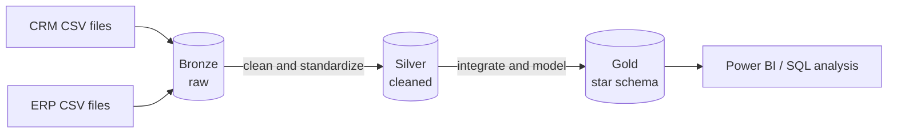
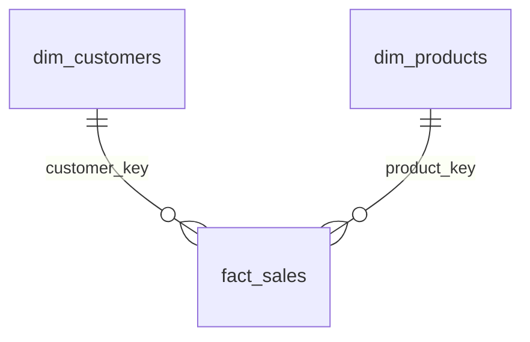

# SQL Data Warehouse Project

A data warehouse built in **SQL Server** using the **Medallion Architecture** (Bronze, Silver, Gold). It combines data from two source systems (CRM and ERP), cleans it, and models it as a **star schema** that is ready for analytics and reporting.

> This is a hands-on learning project built while following the *SQL Data Warehouse* tutorial from [Data With Baraa](https://www.youtube.com/@DataWithBaraa). The code was written, run and debugged by me, and the documentation is mine.

---

## Architecture



| Layer | What it holds | How it is built |
|-------|---------------|-----------------|
| **Bronze** | Raw data exactly as in the source files | Batch load, `TRUNCATE` then `INSERT` |
| **Silver** | Cleaned, standardized data | Stored procedure `silver.load_silver` |
| **Gold** | Business-ready dimension and fact views (star schema) | SQL views over silver |

More detail: [`docs/data_architecture.md`](docs/data_architecture.md)

---

## Data Model (Gold Layer)



- `gold.dim_customers`: customer details enriched with birth date, gender and country
- `gold.dim_products`: products with category, subcategory and cost
- `gold.fact_sales`: sales transactions (quantity, price, sales amount, dates)

Full column list: [`docs/data_catalog.md`](docs/data_catalog.md) | Diagram: [`docs/data_model.md`](docs/data_model.md)

---

## Key Data Quality Problems Solved in Silver

| Problem found in Bronze | Fix |
|-------------------------|-----|
| Duplicate customer IDs | Kept the latest record using `ROW_NUMBER() OVER (PARTITION BY ... ORDER BY ... DESC)` |
| Unwanted spaces in names | `TRIM` |
| Coded values ('M', 'S', 'DE', 'R') | Mapped to readable values with `CASE` |
| Dates stored as integers (`20101229`) | Validated, cast to text, then to `DATE`; invalid values set to `NULL` |
| Missing or wrong sales and price values | Recalculated using `sales = quantity x price` |
| Product history without end dates | Derived `prd_end_dt` with `LEAD()` (next start date minus one day) |
| Product key mixing category and product | Split into `cat_id` and `prd_key` |
| Future birth dates | Set to `NULL` |

## Data Integration in Gold
- CRM and ERP are joined on the customer and product keys ([`docs/data_integration.md`](docs/data_integration.md)).
- **Gender:** CRM is the master source; ERP is used as a fallback.
- **Surrogate keys** are generated with `ROW_NUMBER()` so the fact table does not depend on source IDs.
- The ERP category table is merged into `dim_products` to keep a simple star schema.

---

## Repository Structure

```
sql-data-warehouse-project/
│
├── datasets/                     # Source CSV files (CRM and ERP)
│
├── docs/                         # Project documentation
│   ├── data_architecture.md      # Medallion architecture
│   ├── data_flow.md              # Lineage: bronze to silver to gold
│   ├── data_integration.md       # How CRM and ERP tables connect
│   ├── data_model.md             # Star schema
│   ├── etl.md                    # ETL techniques used
│   ├── data_catalog.md           # Gold layer columns and descriptions
│   └── naming_conventions.md     # Naming rules
│
├── scripts/
│   ├── init_database.sql         # Creates the database and the schemas
│   ├── bronze/                   # Bronze tables and load procedure
│   ├── silver/                   # ddl_silver.sql, proc_load_silver.sql
│   └── gold/                     # ddl_gold.sql (views)
│
├── tests/                        # Data quality checks
│   ├── quality_checks_silver.sql
│   └── quality_checks_gold.sql
│
├── README.md
├── LICENSE
└── .gitignore
```

---

## How to Run

1. Install **SQL Server** and **SSMS** (or Azure Data Studio).
2. Put the CSV files in `datasets/` and update the file paths in the bronze load script.
3. Run the scripts in this order:

| Step | Script | Purpose |
|------|--------|---------|
| 1 | `scripts/init_database.sql` | Create the database and the `bronze`, `silver`, `gold` schemas |
| 2 | `scripts/bronze/` (DDL, then load procedure) | Create the bronze tables and load the raw data |
| 3 | `scripts/silver/ddl_silver.sql` | Create the silver tables |
| 4 | `scripts/silver/proc_load_silver.sql` | Create and run `silver.load_silver` |
| 5 | `tests/quality_checks_silver.sql` | Validate the silver layer |
| 6 | `scripts/gold/ddl_gold.sql` | Create the gold views |
| 7 | `tests/quality_checks_gold.sql` | Validate the gold layer |

---

## Tools and Skills Demonstrated
- **SQL Server**, **T-SQL**, SSMS
- Stored procedures with logging and `TRY...CATCH` error handling
- Window functions (`ROW_NUMBER`, `LEAD`), CTE and subqueries, views
- Data cleansing, standardization and integration
- Dimensional modeling (star schema, surrogate keys)
- Data quality testing and documentation

## Next Steps
- Exploratory Data Analysis (EDA) on the gold layer
- Advanced analytics: trends, running totals, year-over-year, segmentation
- Power BI dashboard on the gold views

---

## Credits and License
Course and dataset: [Data With Baraa](https://www.youtube.com/@DataWithBaraa).
This project is licensed under the [MIT License](LICENSE).

## About Me
**Dharshini** | Aspiring Data Analyst | Chennai, India
[LinkedIn](https://www.linkedin.com/in/dharshini-devaraj-bb39b0249/) | [GitHub](https://github.com/Dharshini56/)

