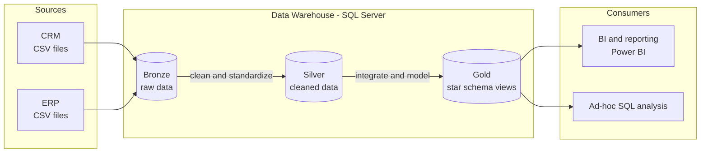

# Data Architecture

The project follows the **Medallion Architecture** with three layers: Bronze, Silver and Gold.

| Layer  | Object type | Load method | Transformations | Data model | Audience |
|--------|-------------|-------------|-----------------|------------|----------|
| Bronze | Tables | Batch, full load (truncate and insert) | None, data stored as-is | None (as source) | Data engineers |
| Silver | Tables | Batch, full load (truncate and insert) | Cleansing, standardization, normalization, derived columns | None | Data engineers, analysts |
| Gold   | Views | No load, views read from silver | Data integration, business logic | Star schema | Analysts, BI tools |
