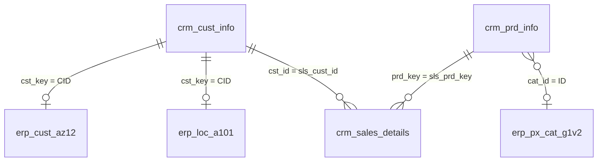

# Data Integration (How CRM and ERP Tables Relate)

The CRM and ERP systems describe the same customers and products with different tables. These are the keys that connect them.

| Join | Condition | Notes |
|------|-----------|-------|
| Customer to ERP birth date and gender | `crm_cust_info.cst_key = erp_cust_az12.CID` | The `NAS` prefix is removed from `CID` in silver. |
| Customer to ERP country | `crm_cust_info.cst_key = erp_loc_a101.CID` | Dashes are removed from `CID` in silver. |
| Sales to customer | `crm_sales_details.sls_cust_id = crm_cust_info.cst_id` | Joined through the surrogate key in gold. |
| Sales to product | `crm_sales_details.sls_prd_key = crm_prd_info.prd_key` | Joined through the surrogate key in gold. |
| Product to category | `crm_prd_info.cat_id = erp_px_cat_g1v2.ID` | `cat_id` is derived from the first part of `prd_key`. |

## Integration rule for gender
CRM is the master source. If the CRM gender is 'N/A', the value from ERP is used instead; if that is also missing, the result is 'N/A'.
