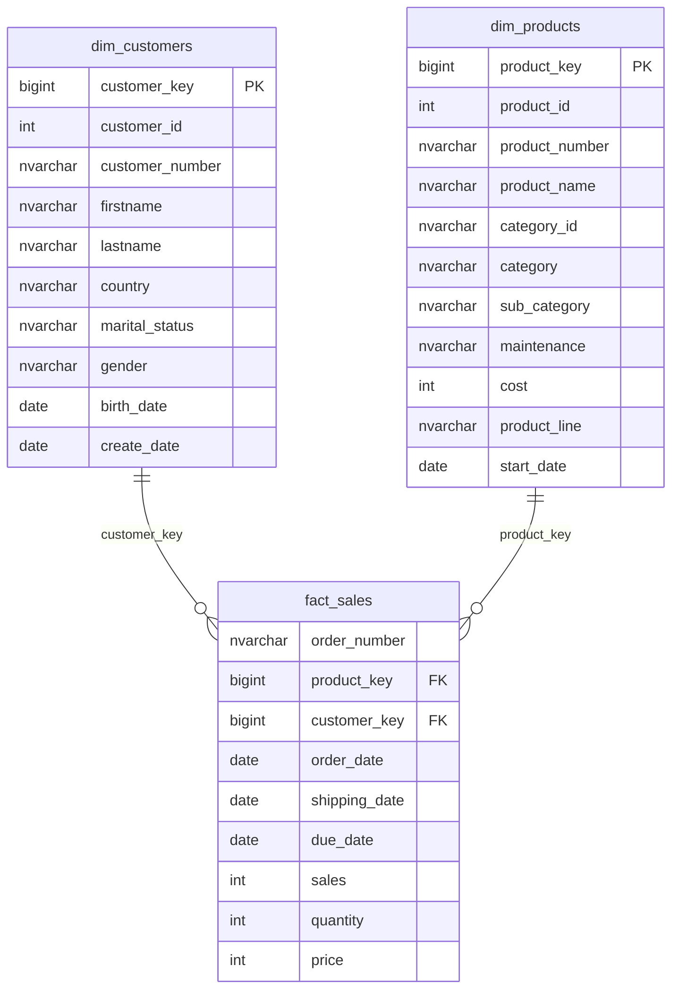

# Data Model: Sales Data Mart (Star Schema)

One fact table (`fact_sales`) in the centre, connected to two dimension tables.

**Business rule:** `sales = quantity x price`.

- **Dimensions** describe the business entities (who and what).
- **Fact** records the measurable events (how much and how many).
- The fact table stores **surrogate keys**, not the source IDs, so it stays independent of the source systems.
